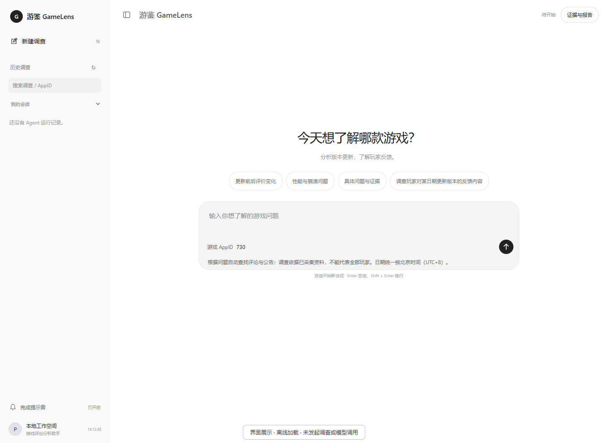
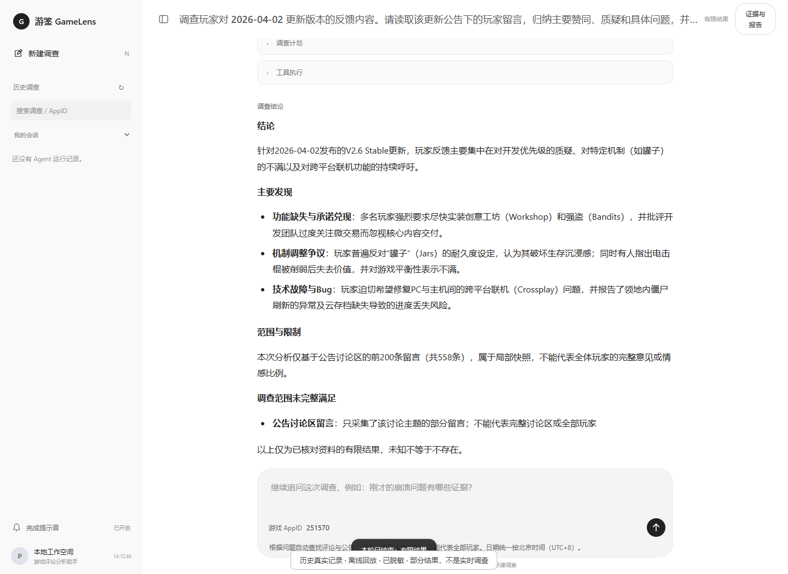
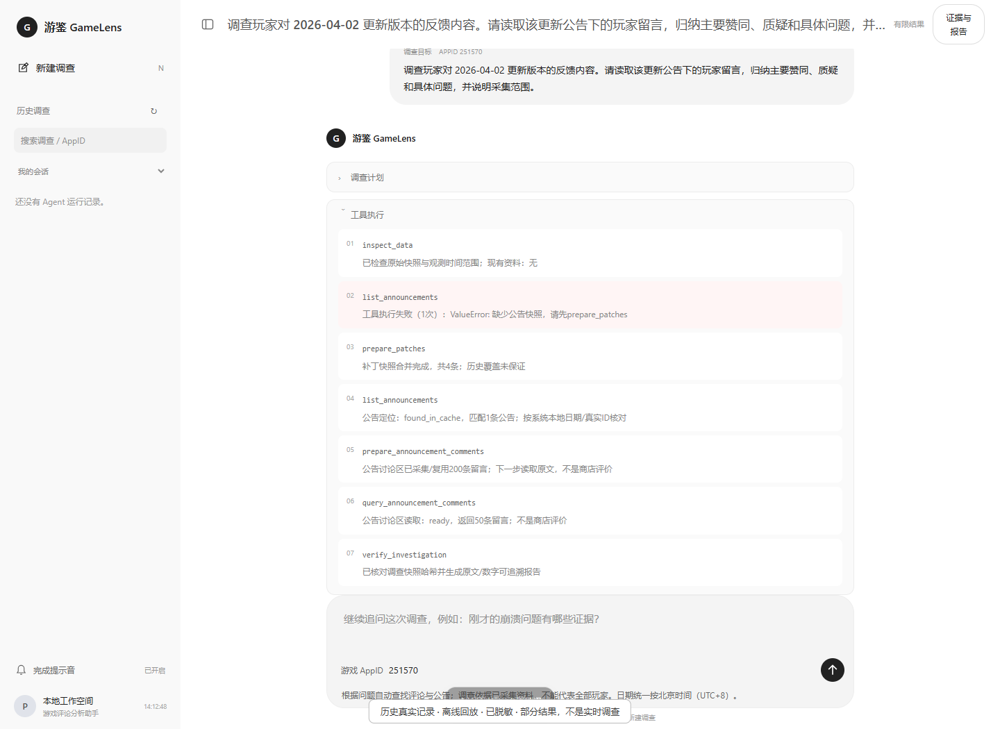
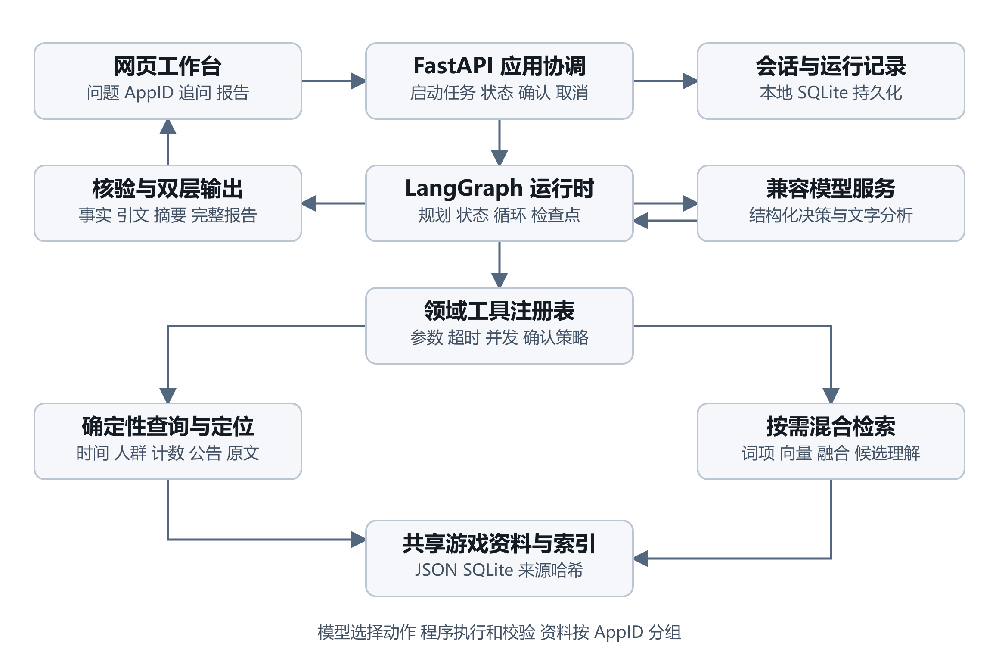
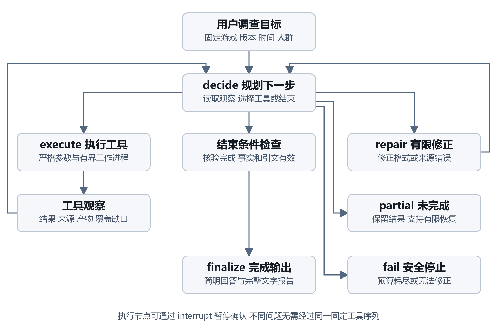

# 游鉴 GameLens

基于 **LangGraph 与 RAG** 的 Steam 游戏更新反馈调查 Agent。本地运行，输入游戏 AppID 和问题，定位更新、整理玩家反馈、执行条件统计，并生成带原文证据和范围说明的报告。

**技术栈：** Python · FastAPI · LangGraph · Pydantic · SQLite · BGE-M3 · HTML/CSS/JavaScript

> 本地单用户项目，以代码、可复现验证和演示为交付目标。没有公开业务服务器，也不宣称已经生产上线。开发过程中使用 AI 辅助。

## 效果预览







截图使用当前真实网页资源离线渲染：首页未发起任务，结论和工具轨迹来自保存的历史调查记录，经脱敏后回放，**不是实时模型调用或完整成功案例**。保留了原记录中的工具错误、补查与有限结果说明；历史 200/558 留言快照不代表当前默认采集数（默认 500、上限 1000）。见 [截图来源说明](docs/presentation.md)。

## 能做什么

- 定位最近或指定日期的补丁，区分官方改动与玩家体验。
- 按日期、语言和游玩时长查询商店评价，比较更新前后样本统计。
- BM25＋BGE-M3 双路召回、RRF 融合，结合证据筛选与原文核验。
- 独立读取某条公告讨论区留言，不用商店评价冒充公告回复。
- LangGraph 状态循环、SQLite Checkpoint、工具进程隔离、有限修复与请求预算。
- 简短 Markdown 结论与详细调查报告；保存运行记录，支持审批与部分中断恢复。

数字由程序计算；语义候选不是总体分母；未采到不能推断不存在。时间统一为 **北京时间 UTC+8（Asia/Shanghai）**，有时区输入保留真实时间点。

## 架构与执行流程





采用受约束的单 Agent：模型提出行动，程序检查参数、权限、预算、来源和完成门槛。统计和精确定位不经过语义 Top-K；RAG 用于查找问题原文并辅助生成。当前没有多 Agent、MCP 服务或外部向量数据库。

可选 BGE Reranker 已实现，但未通过留出召回门槛，默认关闭。图中是逻辑职责概览，实际路由还包含预算、审批和有限结果分支，详见 [设计与源码导航](docs/design.md)。

## 实测结果与边界

以下来自 **2026-11-05 保存的冻结资料评测**，不是生产准确率：

| 检索配置 | Recall@10 | nDCG@10 |
|---|---:|---:|
| Dense | 0.3266 | 0.3258 |
| Hybrid | **0.4030** | 0.3640 |
| Hybrid＋BGE Reranker | 0.4000 | **0.3808** |

3 款游戏、40 道检索题、25 道有效调查题。Hybrid 比 Dense 的 Recall@10 增加约 7.6 个百分点。19 道有可执行工具 Oracle 计划，保存复测为 19/19；其余 6 道不计通过。不同模型的历史 Agent 记录不合并成统一准确率。

[结果与测量口径](docs/benchmark_results.md) · [评测复现与资料边界](docs/benchmark.md)

## 本地运行

已配置环境时，在项目根目录执行：

```powershell
.\.venv\Scripts\python.exe web_app.py
```

打开 `http://127.0.0.1:8000`；`/api/health` 可检查状态。

首次安装（建议 Python 3.13）：

```powershell
python -m venv .venv
.\.venv\Scripts\python.exe -m pip install -r requirements.txt
Copy-Item .env.example .env
```

在本地 `.env` 填写自己的模型配置。测试依赖见 `requirements-dev.txt`；检索依赖见 `requirements-rag.txt`，BGE 权重需要单独准备，参见 `gamelens/rag/cli.py`。模型、真实业务缓存与密钥不随代码分发；不承诺首次克隆即可离线运行真实检索。

新调查可能调用付费模型、触发 Steam 采集或审批。不要在没准备额度和网络时临场启动；已有截图不需要服务器租赁。

## 离线验证

```powershell
.\.venv\Scripts\python.exe -m pip install -r requirements-dev.txt
.\.venv\Scripts\python.exe -m pytest -q
.\.venv\Scripts\python.exe evaluate.py --mode offline --output-dir evals/results/local-offline
```

仓库保留合成测试夹具，真实玩家冻结包保存在本地、不直接公开。工程测试、工具 Oracle、真实 Agent 与 AI 评委是不同证据层，不能互相冒充；新增模型评测需另外设定预算。

## 目录与阅读入口

```text
gamelens/    业务源码：运行时、工具、检索、存储、API、评测
web/         网页资源
tests/       自动化测试和必要夹具
evals/       合成回归资料（真实冻结包、身份映射及运行轨迹不提交）
docs/        设计、评测、脱敏图片与演示说明
```

[文档索引](docs/README.md) · [设计与源码](docs/design.md) · [演示脚本](docs/demo.md)

## 数据、隐私与限制

`.env`、本机数据库、模型、运行报告、原始玩家资料与供应商响应不纳入提交。`.gitignore` 不能替代脱敏或清除已提交的秘密。截图展示的是历史有限结果，不能证明玩家总体意见、当前最新版本或更新的因果效果。小型内部评测集和同模型评委也存在偏差，具体限制见评测说明。
